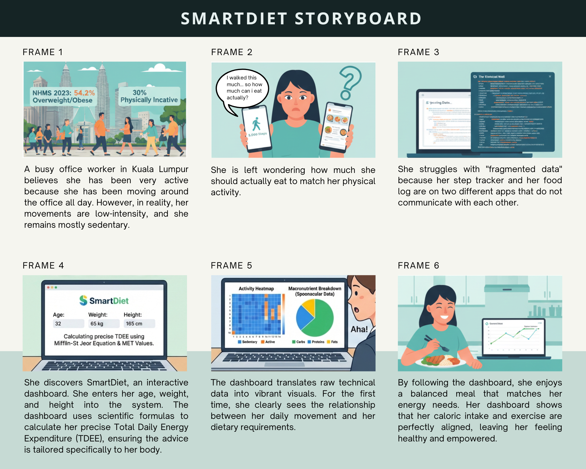
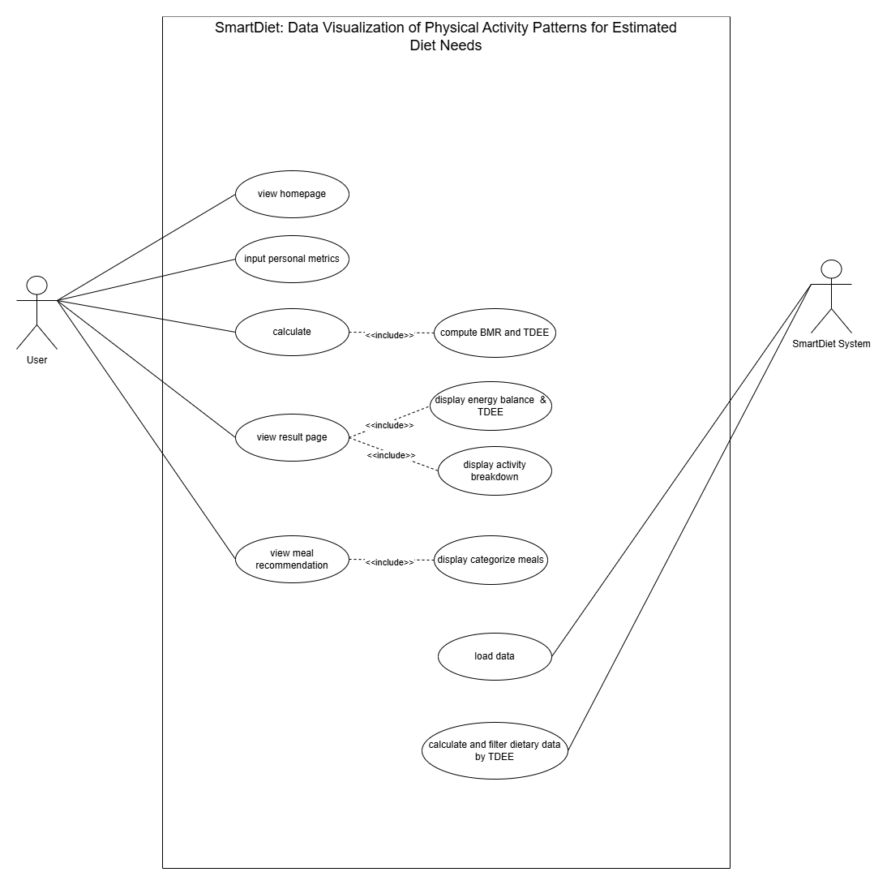

# SmartDiet: Data Visualization of Physical Activity Patterns for Estimated Diet Needs


-success)

SmartDiet is an interactive Power BI dashboard that helps users understand how their physical activity relates to estimated diet needs. It combines activity and nutrition datasets to calculate daily energy requirements (BMR and TDEE) from user inputs, then guides users in exploring food categories and recipes that fit their calorie needs.

> **Final Year Project (FYP)** | CDCS240 | Bachelor of Information Technology (Hons.) | Big Data Track
> Faculty of Computer and Mathematical Sciences, Universiti Teknologi MARA (UiTM)

---

## Table of Contents

- [Problem Statement](#problem-statement)
- [Objectives](#objectives)
- [Features](#features)
- [Dashboard Pages](#dashboard-pages)
- [Datasets](#datasets)
- [Methodology](#methodology)
- [Design Documentation](#design-documentation)
- [Usability Testing (SUS)](#usability-testing-sus)
- [Repository Structure](#repository-structure)
- [Getting Started](#getting-started)
- [Limitations & Disclaimer](#limitations--disclaimer)
- [Author & Supervisor](#author--supervisor)

---

## Problem Statement

Most fitness and diet tools provide fragmented information: activity tracking and diet planning are rarely integrated. Even when users know how many calories they burn, they often receive no clear dietary guidance. This is a particular concern in Malaysia, where obesity and physical inactivity remain high.

SmartDiet addresses this gap by linking physical activity data with nutrition data in a single, easy-to-use dashboard.

## Objectives

1. To identify the data and system requirements for SmartDiet.
2. To design SmartDiet: Data Visualization of Physical Activity Patterns for Estimated Diet Needs.
3. To develop SmartDiet as an interactive Power BI dashboard.

## Features

- **Personalized calorie estimation:** BMR and TDEE calculated from age, gender, weight, height and activity level
- **Activity intensity comparison:** compare calorie burn rates across activities (jogging, walking, standing, sitting)
- **Interactive food calorie exploration:** an "Eat vs. Avoid" treemap by food category
- **Recipe and meal filtering:** filter by cuisine, vegan, vegetarian and gluten-free options
- **Macronutrient breakdown:** fat, protein and carbohydrate proportions of recommended meals
- **User-driven controls:** slicers, buttons and page navigation for a guided experience

## Dashboard Pages

| # | Page | Description |
|---|------|-------------|
| 0 | **Home** | Landing page with a "Start Analysis" button |
| 1 | **User Profile** | Input age, gender, weight, height and activity level, then click *Calculate Now* |
| 2 | **Activity and Energy** | Shows BMR, daily calorie target (TDEE), calorie burn rate comparison and hours needed to burn calories per activity |
| 3 | **Personalized Nutrition & Meal Advisor** | "Eat vs. Avoid" treemap that colour-codes food categories (green = recommended, yellow = moderate, red = limit) |
| 4 | **Meals Recommendations** | Recipe table with calories and macronutrients, filterable by cuisine and dietary preference, plus a fat/protein/carbs donut chart |

### Screenshots

<!-- Replace the paths below with your actual screenshot files -->
| User Profile | Activity and Energy |
|---|---|
|  |  |

| Nutrition & Meal Advisor | Meals Recommendations |
|---|---|
|  |  |

A full PDF export of the dashboard is available in [`docs/Dashboard_SmartDiet.pdf`](Docs/Dashboard_SmartDiet.pdf).

## Datasets

| Dataset | Year | Purpose |
|---------|------|---------|
| Calories Burned | 2023 | Activity type, intensity level, MET values and estimated calorie burn |
| Food Calorie | 2023 | Calories per 100 g and serving size for various food items |
| Fruits and Vegetables Nutrition | 2022 | Calorie and nutrient information |
| Recipe | 2023 | Meal calories and nutrition data for recipe exploration |

> Please check the original source and licence of each dataset before redistributing the raw data.

## Methodology

The project follows a hybrid **Agile-OSEMN** approach:

- **Agile** supports iterative dashboard development and refinement.
- **OSEMN** guides the data workflow: **O**btain, **S**crub, **E**xplore, **M**odel, **I**nterpret.

Data cleaning and preparation were completed before loading into Power BI, where the calculations (DAX measures) and visual analytics were built.

## Design Documentation

### Storyboard

The storyboard follows a busy office worker in Kuala Lumpur who believes she is very active but is actually mostly sedentary. It illustrates the problem of fragmented data (step tracker and food log in separate apps) and how SmartDiet helps her connect her daily movement with her dietary needs, from entering her profile to seeing her energy balance and enjoying a meal that matches her needs.

The storyboard also highlights the motivating statistics behind the project: 54.2% of Malaysian adults are overweight/obese and about 30% are physically inactive (NHMS 2023).



### Use Case Diagram

The use case diagram defines how the two actors interact with the system:

- **User:** view homepage, input personal metrics, calculate (includes *compute BMR and TDEE*), view result page (includes *display energy balance & TDEE* and *display activity breakdown*), and view meal recommendation (includes *display categorized meals*).
- **SmartDiet System:** load data, and calculate and filter dietary data by TDEE.



## Usability Testing (SUS)

The dashboard was evaluated with the System Usability Scale (SUS):

- **Respondents:** 10 users
- **Average SUS score:** **81.75**
- **Grade:** A (excellent), meaning the system is considered easy to use, efficient and user-friendly

## Repository Structure

```
SmartDiet-PowerBI/
├── README.md
├── .gitignore
├── dashboard/
│   └── FYP_SmartDiet.pbix
├── design/
│   ├── SmartDiet_Storyboard.png
│   └── SmartDiet_UseCaseDiagram.png
├── docs/
│   ├── Poster_SmartDiet.pdf
│   └── Dashboard_SmartDiet.pdf
└── screenshots/
    ├── 01_home.png
    ├── 02_user_profile.png
    ├── 03_activity_energy.png
    ├── 04_nutrition_advisor.png
    └── 05_meals_recommendations.png
```

## Getting Started

### Prerequisites

- [Power BI Desktop](https://powerbi.microsoft.com/desktop/) (free, Windows only)

### Run the dashboard

1. Clone or download this repository:
   ```bash
   git clone https://github.com/<your-username>/SmartDiet-PowerBI.git
   ```
2. Open `dashboard/FYP_SmartDiet.pbix` in Power BI Desktop.
3. Go to the **User Profile** page and enter your details.
4. Click **Calculate Now**, then navigate to the other pages using the side menu.

> If Power BI shows a data source error, go to **Home > Transform data > Data source settings** and update the file paths to your local copy of the datasets.

## Limitations & Disclaimer

SmartDiet is an **educational tool** intended to raise awareness of healthy habits. It is **not a medical tool** and does not replace advice from a doctor, dietitian or other qualified health professional.

## Author & Supervisor

- **Prepared by:** Nurfarisha binti Mohd Kamal (Big Data Track)
- **Supervised by:** Dr Nor Diana binti Ahmad
- **Institution:** Faculty of Computer and Mathematical Sciences, Universiti Teknologi MARA (UiTM)

---

*If you find this project useful, consider giving it a star.*
